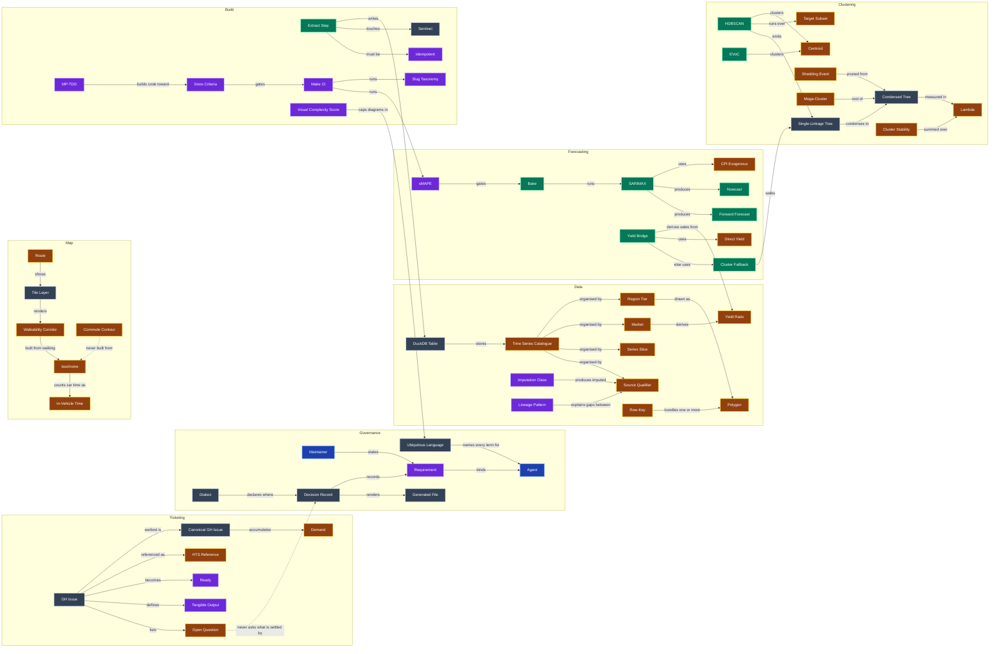

# Glossary

The ubiquitous language for `hows-the-serenity`.
Each term is written in Title Case wherever it is used, to mark it as this glossary's meaning rather than the plain-language one.
When a new domain term enters the code or the conversation, add it here in the same change.
Give it its own H2 and a place in the diagram.

## Agent

An AI coding assistant working in this repo, such as Claude Code or Codex.
Every Agent is bound by the instructions in [AGENTS.md](../AGENTS.md).

## Bake

Run the SARIMAX forecast step end-to-end; writes `forecasts` + `forecast_diagnostics` into the shipped DuckDB.

## Canonical GH Issue

The earliest GH Issue for a piece of work; later duplicates close into it.
See [TICKETING.md](TICKETING.md).

## Centroid

The geometric centre `(lat, lon)` of a polygon.
The ONLY metric used by HDBSCAN and EVoC in this project — *no rental/sales features influence the cluster shape*.

## Cluster Fallback

Sales SALs without direct rental — walk the SAL agglomerative hierarchy to the smallest cluster with enough rental-bearing siblings; use cluster median rent.
Each fallback row carries `source='cluster_fallback'` + `cluster_id` + `cluster_level`.

## Cluster Stability

`S(C)`: `Σ (λ_p − λ_birth(C))` — the area of cluster C's bar in HDBSCAN's icicle plot.
Drives flat-cluster selection (EOM).

## Commute Contour

A line joining places with the same travel time to a hub when **riding** a train, tram or bus.
Labelled on the map like `train 15m`.
Aliases: commute hull.

A Walkability Corridor and a Commute Contour for the same mode are different outcomes: one answers "can I walk to the bus?", the other "where does the bus get me in 30 minutes?".

## Condensed Tree

The smaller tree HDBSCAN derives by collapsing every "shedding" merge (where one side is < `min_cluster_size`).
Computed client-side via `condenseLinkageTree`.
Spec: `docs/specs/hdbscan_condensed_dendrogram.md`.

## CPI Exogenous

ABS Melbourne All-groups CPI, base 2011-12=100.
Used as the `exog` regressor for every rental bake — it leads rental/sales publish cadence so it carries *real, observed* values for the nowcast window.

## Decision Record

One accepted decision in the ADR surface, [`adrs/`](../adrs/index.md).
It is never rewritten, and a later Decision Record supersedes it through a typed relation.
See [ADR-0001](../adrs/0001-record-decisions-as-okf-yaml.md).

## Demand

A GH Issue's duplicate count plus its total reactions.

## Dialect

This repo's declared documentation conventions, in [CONVENTIONS.md](CONVENTIONS.md).

## Direct Yield

A SAL whose sales has a matching rental row in `suburb_mappings.json` (203 of 760 sales SALs).

## Done Criteria

The 7 explicit checkboxes at `docs/specs/forecasts.md:57-63` that gate spec completion.

## DuckDB Table

A table in the shipped database `public/data/rental_sales.duckdb`.

| Table | Rows | Purpose |
|---|---|---|
| `rental_sales` | 423,930 | Vendor observations + imputed rows (tagged `source_file LIKE 'imputed:%'`). |
| `cpi` | 109 | ABS Melbourne All-groups CPI quarterly index, base 2011-12=100. |
| `forecasts` | 21,382 | SARIMAX nowcasts + forward forecasts per series. |
| `forecast_diagnostics` | 1,878 | Per-series sMAPE + Ljung-Box / Jarque-Bera p-values. |
| `forecast_diagnostics_corroboration` | — | Cross-tier corroboration rows (SAL cluster median vs LGA rental at the matching dendrogram level). |
| `forecast_models` | — | Per-series fitted-model metadata. |
| `yields` | — | Computed yield bridge rows: `source ∈ {suburb_direct, cluster_fallback}`. |
| `cluster_linkage` | 2,647 | Unified HDBSCAN + EVoC linkage rows per (tier, method). |
| `geographic_hierarchy` | 9,126 | Legacy K-cut snapshot tables (still consumed by forecast bake's corroboration check). |
| `cluster_centroids` | 48 | Per-cluster centroid cache. |

## EVoC

Extreme Versatile Outlier Clustering.
The project's second clustering method; produces an n-ary `cluster_tree_` natively.

## Extract Step

Self-contained Python module under `etl/steps/extract_*.py` or `etl/steps/build_*.py` that pulls one upstream source into one DuckDB table or one converted artifact.

## Forward Forecast

Predicting past today; separate decision from nowcasting.

## Generated File

A file rendered from a source by the repo's regenerate command, and never edited by hand.
Example: every `adrs/*.md`, `graph.json` and `graph.html`, generated by `make adrs`.

## GH Issue

One GitHub Issue; the repo's unit of tracked work.
See [TICKETING.md](TICKETING.md).

## HDBSCAN

Density-based clustering.
The project runs it with `min_samples=1` so mutual reachability collapses to plain Euclidean over centroids.

## HTS Reference

`HTS-{n}`: work reference for GH Issue `#n`, used in branch, worktree and PR names.

## Idempotent

Re-running a step produces byte-identical output (forecasts) or strips its own prior rows before re-writing (impute).
Required by spec G1.

## Imputation Class

The method that fills a missing slice, from `docs/specs/impute.md`.

| Class | What it fills | Method |
|---|---|---|
| **A** | Rental per-dwelling all-bedrooms rollup | Count-weighted mean of per-bedroom children |
| **B** | Sales SAL per-bedroom disaggregation | `sale_bedroom = sale_dwelling_all × (rental_bedroom / rental_dwelling_all)` |
| **C** | Sales SAL all-dwellings rollup | Combine observed `{unit,house}×all` sale medians weighted by Class-A rental dwelling-count mix |
| **D** | Sales LGA roll-up from SAL | Equal-weight mean of member SALs via GeoPandas SAL→LGA crosswalk |

Every imputed row's `source_file` carries the prefix `imputed:<class>` (e.g. `imputed:rollup_rental_dwelling_all`).

## In-Vehicle Time

In an Isochrone, time spent **driving a personal car**.
It never means time on a train, tram or bus.

## Isochrone

The area reachable from a point within a set time by **walking, cycling or driving a personal car**.
Never public transport.

## Lambda

λ: `1 / distance`.
HDBSCAN's vertical axis; large λ = high density.
Long edge-length in the condensed dendrogram = stable cluster (high λ-persistence).

## Lineage Pattern

A recurring cause of disagreement between a slice's `observed` / `imputed` / `forecast` polygon sets, from `src/lib/cell-lineage.ts`.
Surfaced in `<LineagePanel>` on `/explore/overview`.

| Code | Name | Cause |
|---|---|---|
| **P1** | `VENDOR_GAP` | Vendor publishes nothing for this slice — impute fills the entire polygon population from scratch (e.g. LGA house-all). |
| **P2** | `OBSERVED_NOT_REIMPUTED` | Impute is idempotent; observed cells are intentionally not re-imputed. |
| **P3** | `BELOW_SARIMAX_MIN_OBS` | Forecast bake skips series with < ~40 quarterly obs. |
| **P4** | `CROSS_TIER_IMPUTE_EXPANSION` | Class C/D derives the slice via cross-tier signal, reaching polygons the vendor never touched. |
| **P5** | `MULTI_SAL_GROUP_EDGE_CASE` | Tiny diff (≤2 polygons) caused by vendor multi-SAL group strings splitting unevenly between cohorts. |
| **P6** | `UNCLASSIFIED` | Falls through none of the above — investigate manually. |

## Maintainer

The owner of this repo.
Only the Maintainer states a Requirement.

## Make CI

`make ci`: the full local CI gate — mirrors GitHub Actions.
Includes audit, build, format-check, typecheck, lint, ADR audit, unit tests, e2e, diagnostics gate.

## Market

One of the two source markets or the derived one.

| Market | Code | Vendor source | Tier coverage |
|---|---|---|---|
| **Rental** | `rental` | DV398 weekly median rents | SAL + LGA |
| **Sales** | `sales` | DV398 annual median prices | SAL only (LGA via Class D impute rollup) |
| **Yield ratio** (derived) | `yield_ratio` | `rental_weekly × 52 / sale_price` | derived from rental + sales |

## Mega-Cluster

The root of any dendrogram — the cluster that contains every polygon.

## MP-TDD

The project's vertical-slice TDD skill (`.claude/skills/mp-tdd`) — one test → one impl, no horizontal batches.

## Nowcast

Imputing the data-release lag between a variable's last observed point and today, using CPI as a leading indicator.

## Open Question

An ambiguous requirement on a GH Issue that no Decision Record resolves, labelled `HTS{n}-Q01`, `HTS{n}-Q02` and so on.
See [TICKETING.md](TICKETING.md).

## Polygon

One geometry in the SAL/LGA GeoJSON (one SAL_CODE21 or LGA_CODE24).

The `/explore/overview` cells show **polygon counts** (flattened) so the map below paints exactly what the count claims.

## Ready

A GH Issue whose every `blocked by` GH Issue is CLOSED.

## Region Tier

One of the two boundary sets every series is published against.

| Tier | Code | Polygon count (Victoria) | Source GeoJSON |
|---|---|---|---|
| **SAL** (Suburb and Locality, ABS 2021) | `sal` | 2,946 | `public/data/selected_sal_2021_aust_gda2020.geojson` |
| **LGA** (Local Government Area, ABS 2024) | `lga` | 80 | `public/data/selected_lga_2024_aust_gda2020.geojson` |

`geospatial_type` in DuckDB uses **`suburb`** (legacy) ≡ `sal` and **`lga`** ≡ `lga`.
Frontend types prefer `sal`/`lga` everywhere; queries translate at the boundary.

## Requirement

Something the Maintainer has stated the project must do or must never do.
Binding Requirements are recorded as Decision Records in [`adrs/`](../adrs/index.md).

## Route

A page of the app.

| Route | What it shows | Component |
|---|---|---|
| `/` | Main map (deck.gl + MapLibre); selecting a polygon opens the rental/sales/(yield) plot | `App.tsx` |
| `/explore/overview` | Coverage matrix + Deck.GL polygon overlays + lineage classifier + per-polygon presence matrix | `OverviewSummary.tsx` |
| `/explore/sal/:id` | Per-SAL dual-plot inspector | `RegionExplorer.tsx` |
| `/explore/lga/:id` | Per-LGA dual-plot inspector | `RegionExplorer.tsx` |
| `/explore/dendrogram/:tier` | Cytoscape dendrogram (HDBSCAN condensed or EVoC n-ary) | `DendrogramExplorer.tsx` |

The `/explore/*` subtree is gated by `VITE_ENABLE_EXPLORE=true` at build time; production deploys (GitHub Pages) ship the map only.

## Row-Key

What the vendor publishes as one bundled series (the `geospatial_codes` column) — sometimes a single polygon code, sometimes a hyphen-joined multi-SAL group string like `"20018-21677"`.
After flattening on `-`, **813 forecast polygons live behind 814 forecast row-keys** (759 singletons + 55 multi-SAL group strings = 47×2 + 8×3).

| Metric | Counts polygons? |
|---|---|
| `COUNT(DISTINCT geospatial_codes)` | No — counts vendor row-keys |
| `COUNT(DISTINCT UNNEST(STRING_SPLIT(geospatial_codes, '-')))` | Yes — counts polygons |
| `flattenCellCodes()` in TS (`src/lib/cell-polygons.ts`) | Yes |

## SARIMAX

Seasonal ARIMA with exogenous regressors.
The bake's chosen model family.
Series with fewer than ~40 quarterly observations are skipped by the bake (Below SARIMAX min-obs, gap pattern P3 in the lineage classifier).

## Sentinel

Empty file under `data/converted/.*.sentinel` whose mtime tracks "the DuckDB table was last written".
Used as a Make dependency target so the build is data-driven without re-running on no-op.

## Series Slice

One dwelling + bedrooms combination.
The user calls this "9 series per region per market". Three categories:

| Category | Slice | dwelling_type | bedrooms |
|---|---|---|---|
| **Granular** (6) | House 2br | `house` | `2` |
| | House 3br | `house` | `3` |
| | House 4br | `house` | `4` |
| | Unit 1br | `unit` | `1` |
| | Unit 2br | `unit` | `2` |
| | Unit 3br | `unit` | `3` |
| **Dwelling rollup** (2) | House (all) | `house` | `all` |
| | Unit (all) | `unit` | `all` |
| **Regional rollup** (1) | All-properties | `all` | `all` |

Bedroom×dwelling combinations not listed (e.g. `house/1`, `unit/4`, `all/1..4`) are vendor schema-impossible and excluded from the Cartesian product (see `docs/specs/impute.md` §Universe for the formal exclusion list).

## Shedding Event

A binary merge where one side is too small to count as a cluster.
The small side's points "fall out" of the parent at that λ.

## Single-Linkage Tree

The full scipy-style binary linkage matrix HDBSCAN emits (`single_linkage_tree_`).
Persisted into `cluster_linkage` with one row per node.

## Slug Taxonomy

The e2e test pattern (`e2e/explorer.spec.ts`): each (region, kind) becomes a deterministic test with paired artefacts (`<slug>.png`, `<slug>.log`, `<slug>.network.json`).

## sMAPE

Symmetric Mean Absolute Percentage Error.
The forecast-quality gate: `make ci` fails if rental median sMAPE > 15%.
Current: 0.0278.

## Source Qualifier

Where a value came from. The user defined these literally:

> - **observed**: the real measured data from primary sources
> - **imputed**: derived from a time-series model from source data to
>   infer equivalent series
> - **forecasted**: time-series modelled but for data in the *future* of
>   the data we have

For the **derived `yield_ratio` series only**, the qualifier is composite:

| Yield qualifier | Definition | Display |
|---|---|---|
| **observed** | Both numerator rental AND denominator sales are observed | Solid line |
| **partially_imputed** | Either the rental or the sales (not both) is imputed | Dashed line |
| **fully_imputed** | Both rental and sales are imputed | Dotted line |
| **forecast** | Any input is a forecast row | Same dotted style as other forecasts; matches the granularity colour to encode fidelity |

A `geospatial_codes` row whose `source_file LIKE 'imputed:%'` is imputed; otherwise observed.
Forecast rows live in the separate `forecasts` table.

## Tangible Output

The concrete, checkable thing that exists when a GH Issue's work is done, such as a map layer, dataset file, page or deployed resource.
Two GH Issues with different Tangible Outputs are different work.
See [TICKETING.md](TICKETING.md).

## Target Subset

The polygon set HDBSCAN/EVoC actually run over: polygons that have observed source data AND are being imputed (per `observed_regions.json` × the impute coverage).
760 SAL + 79 LGA.

## Tile Layer

A pre-tiled MVT/XYZ tree rendered by deck.gl's `MVTLayer`.
Output dirs under `public/tiles/<key>/{z}/{x}/{y}.pbf` are populated by ETL subcommands.

| Key | Source | Toggle |
|---|---|---|
| `suburbs` | SAL parquet → MVT | Map ControlPanel |
| `iso_foot_5` / `iso_foot_15` | Dissolved walkability corridors (5min / 15min isochrones) | Map ControlPanel |
| `ptv_lines_<mode>` / `ptv_stops_<mode>` | Public-transport lines + stops per mode (metro_train / metro_tram) | Map ControlPanel |
| `school_zones_<level>` | *(NEW — Task 4)* DataVic 2026 school catchment zones | TBD |

## Time Series Catalogue

What the whole product centres on, organised along four orthogonal axes.
Every cell in the product (forecast row, map polygon hover, dendrogram leaf, overview cell) is one combination of:

1. **Region tier** — one of `sal` / `lga`
2. **Market** — one of `rental` / `sales` / (derived) `yield_ratio`
3. **Dwelling + bedrooms slice** — one of 9 (see Series Slice)
4. **Source qualifier** — one of `observed` / `imputed` / `forecasted`

## Ubiquitous Language

This document.
Every term has exactly one meaning across docs, code identifiers, and UI copy.

Sources:
- The user's explicit definitions in the four-task prompt that triggered this doc.
- Recurring vocabulary mined from ~/.claude/projects/.../*.jsonl human messages (155 unique).
  Direct phrasing is quoted where it shaped a definition.

Phrases the user actually uses (verbatim, from session logs), surfaced unedited so future code search lands on the user's phrasing, not invented synonyms:

- "9 series" / "granular series" / "dwelling rollups" / "regional rollup"
- "region boundary types"
- "series source qualifiers"
- "yield ratios can vary by geographic area"
- "walkability corridor" / "walkability areas"
- "agglomerative hierarchy" / "natural SAL hierarchical clustering"
- "LGA data as a corroborating feature that matches our equivalent in the hierarchy"
- "imputed and forecasted should be very clearly labelled"
- "the heirarchical model allows..." *(sic — common user spelling)*
- "intermediate ts_models.db"
- "feature flags (layer enabled)"
- "models" route / "models" sub-pages
- "tile" / "tile layer" / "premake all the sliced, diced and simplified geometries in advance"
- "cache busting tiles"
- "dead tiles" (404s for tiles outside the known range)
- "hex layer" / "H3HexagonLayer" / "pixelated map fill"
- "fully granular detail" (tooltip should expose suburb, date, dwelling, bedrooms)
- "pull up the detailed charts"
- "MULTI_SAL_GROUP" group strings as `"SAL1-SAL2"`
- "polygons we have source data and are creating the imputed series" = **target subset**
- "Cytoscape dendrogram" with "mega-cluster at top, leaves at bottom"
- "edge length proportional to the distance represented by that cluster node joining"
- "Model Details section" (per-series fitted-coefficients panel)
- "shedding event" (HDBSCAN condensation)
- "ubiquitous language" (← the call for this doc)

## Visual Complexity Score

VCS: the metric `mermaid_complexity.ts` uses to enforce the 50-node cognitive-load threshold per Mermaid diagram.

## Walkability Corridor

The dissolved walking Isochrones around a public-transport line's stops: how far you can walk to reach the service.
Example: `iso_foot_5` / `iso_foot_15`.

## Yield Bridge

The rental/sales pipeline that derives sales projections from rental forecasts × inverse yield, since sales has only 11 annual obs (statistically infeasible to model directly).

## Yield Ratio

The derived Market: `rental_weekly × 52 / sale_price`.
Its Source Qualifier is composite (see Source Qualifier).
